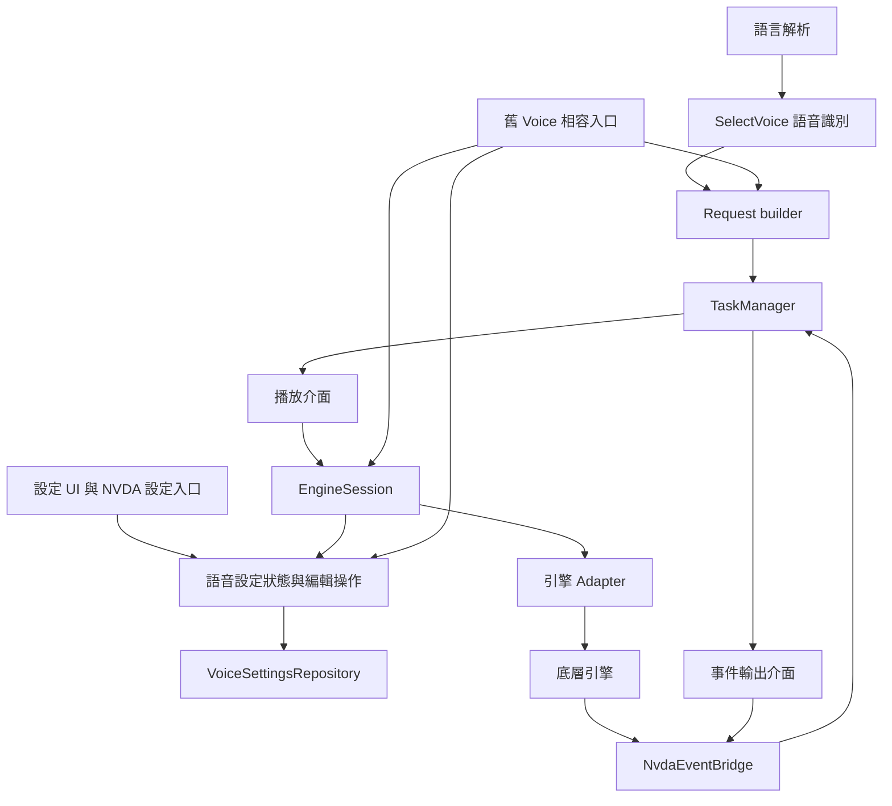

# F5、F6、A1、A4：語音設定、引擎播放與排程邊界

日期：2026-09-26。

狀態：使用者已審閱並核准，進入實作計畫階段。

## 1. 目的與已確認的決策

本設計對應根目錄 `review_gpt1.md` 的 F5、F6、A1、A4：修正 OneCore 快取語音切換與不可用引擎後的路由恢復，並拆分語音設定、引擎操作、排程及 NVDA 事件轉接的責任。

使用者已確認以下決策：

1. 本次完成 F5、F6、A1、A4。F7 的各引擎取消後回呼排空契約另行處理。
2. F6 採用跳過策略：不可用語音區段的文字、index 與停頓一併跳過；持續處理語音切換命令，遇到可用語音後恢復，不自動改用預設語音。
3. 採用方案一：內部建立新介面，保留現有 Voice 與引擎接入方式的相容入口。
4. **之後可移除相容層，排程與設定邏輯無須重寫。** 此項是本次驗收要求。
5. 保留設定於下一段開始時生效、取消與暫停即時處理，以及設定預覽／儲存／取消的交易邊界。
6. Builder、TaskManager 與新設定元件使用新介面；舊介面的差異集中在相容層。

本次交付包含修正、架構遷移與必要的行為驗證，不以新增類別但保留原有相互依賴作為完成條件。

## 2. 現況與既有設計的關係

目前已有 `driver/engineSession.py`、不可變的 `VoiceSnapshot` 與設定版本。F4 的實作已將 OneCore 的 `language` 更新移到 `applyEngineSettings()`，因此 F5 應先驗證現有路徑，再隨介面遷移保留其行為；不能只依原始審查文字重做相同修正。現有 OneCore adapter 測試主要檢查套用 hook，尚需以同一 Session 與快取語音驗證 A → B → A。

`requestBuilder.py` 仍在識別語音切換命令前檢查目前引擎是否可用，因此 F6 的不可恢復路徑仍存在。

目前 `Voice` 同時持有設定、commit 基準、core、Session、TaskManager 與引擎生命週期入口。`EngineSession` 主要負責參數套用；TaskManager 仍直接讀取 `voice.core`、呼叫引擎並註冊及發送 NVDA 事件。`VoiceManager.waitfactor` 仍依 VE／Cerence 的具體型別決定行為。

本設計延續以下文件的使用者可見行為，並更新其責任分配：

- [F4：語音設定於下一段開始時生效](2026-09-25-f4-voice-activation-design.md)。本次將設定狀態移出 Voice，將播放控制集中到 Session。
- [語音請求生命週期設計](2026-09-24-speech-request-lifecycle-design.md)。本次將 core 身分與 NVDA 事件處理移到 Adapter／Bridge，保留其中的取消、同步通知與一次完成規則。

F2、F3 等修正已在撰寫實作計畫期間納入提交 `6256a23`。後續實作須以包含此提交的當前工作目錄為基礎保留其修正，不能以還原檔案或搬回舊版本的方式進行遷移。

## 3. 範圍與相容性

本次涵蓋 WorldVoice 主入口、語音解析／request builder、TaskManager、VoiceManager、共用 Voice 相容入口、各引擎的 WorldVoice adapter、設定操作呼叫端與相關測試。

內建引擎為 VE、Cerence、RHVoice、Espeak、OneCore、SAPI5。現有 manifest discovery 與引擎啟用設定繼續作為接入來源；外部引擎透過舊介面轉接器接入新架構。相容性以目前載入器及呼叫端使用的生命週期、語音列舉、參數與播放契約為依據；外部引擎的實際執行結果須另以可取得的引擎驗證。

本次不要求變更原生 DLL、NVDA 原始碼、`ref/` 或內嵌的底層 driver 實作。既有 VE／Cerence 的取消防護保留在 WorldVoice 包裝層，並維持其 token 傳遞語意。

設定檔 key、語音識別與角色 mapping 格式維持相容。Repository 遷移須保留目前型別轉換、預設值及主語音參數一致性的載入規則。

F7、A2 的 discovery／registry 重構，以及 A3 的 pipeline／設定描述來源整理不納入本次。建立本次所需的 Session 查詢表與能力宣告，不代表擴大為完整 registry 改造。

## 4. 架構與依賴方向

相容層依賴新介面；新排程與設定元件不匯入舊 Voice 類別。新核心模組須放在不會因 package 初始化而間接載入舊 Voice 的位置；必要時，舊模組路徑只保留重新匯出的相容入口。圖中的事件流不代表 TaskManager 可以取得 core；原生事件來源只由 Adapter 與 Bridge 辨識。

| 元件 | 責任 | 不得承擔的責任 |
| --- | --- | --- |
| 語音描述 | 不可變的語音 key、引擎、ID、語言與顯示資訊 | 播放、保存設定 |
| 語音設定狀態 | 待生效參數、revision、不可變快照、編輯回復基準 | core 操作、NVDA 全域事件 |
| VoiceSettingsRepository | 載入及保存語音參數、套用既有設定規則 | 排程、引擎啟用 |
| EngineSession | 引擎資源所有權、啟用記錄、播放與控制 | 直接讀寫 config、保存 UI 交易 |
| 引擎 Adapter | 操作底層引擎、套用引擎專用參數、提供能力與事件來源 | 決定 request 是否完成 |
| TaskManager | request 狀態、task 順序、取消、等待與通知判定 | 存取 core、辨識引擎型別、註冊 NVDA 全域事件 |
| NvdaEventBridge | NVDA 註冊／解除、來源對應、對外通知 | 維護 request remaining、推進佇列 |
| 相容層 | 將舊 Voice／引擎入口轉成新介面操作 | 另存一份設定或另寫一套排程 |

沿用或調整現有 `VoiceMeta`、`VoiceSnapshot` 即可表達語音描述與參數快照，避免建立欄位相同而需要同步的模型。設定狀態與 Repository 分別承擔記憶體狀態及持久化，兩者不能互相隱含建立引擎。

## 5. 新介面與相容層

### 5.1 排程所需的播放介面

以小型 Protocol 或等價的明確介面提供以下操作。實際命名可在實作計畫決定，但責任及資料限制固定：

- 取得不透明的事件來源識別，用於比對 Session 的事件。
- 依語音 key 啟用設定；Session 在此步驟取得最新快照。
- 播放該段 commands，接收 request 的取消 token。
- 取消播放、暫停／恢復。

TaskManager 的 task 保存播放介面、語音 key 與段落資料，不保存舊 Voice 或捕捉舊 Voice 的任意播放閉包。停頓是獨立的 task 類型，由 token 的可中斷等待執行，不需要啟用語音。

引擎初始化、關閉、語音列舉、變體清單及設定儲存不加入排程的播放介面。VoiceManager／組裝入口依各自所需的介面使用這些功能。

### 5.2 引擎能力與差異

Adapter 宣告其支援的通用參數與額外能力。VE／Cerence 宣告 waitfactor 與 variant；OneCore 在啟用設定時同步 language。取消 token 是否能傳入原生 `speak()`，仍以引擎實例實際支援的能力為準，不因引擎名稱就假定支援。

VoiceManager 依能力更新 waitfactor，UI 依參數／變體能力建立設定選項。能力查詢不得切換目前播放語音或改寫參數。原有 metadata 讀取若需要引擎專用操作，由 Adapter 封裝。

### 5.3 舊介面轉接

相容層有兩個方向：

1. **舊呼叫端入口**：Voice 的參數屬性、載入、commit、rollback、播放及控制方法，轉交新設定、request 建構與 Session。語音資料從同一份描述取得。
2. **舊引擎接入入口**：既有引擎類別的啟動／關閉、core、metadata 與引擎專用參數 hook，包裝成新的 Adapter 契約。

新 Session 不呼叫舊 Voice 的 `active()`／`speak()` 來實作自己的啟用或播放，避免「Voice 委派 Session，Session 又回呼 Voice」的循環。既有引擎專用 hook 可以暫時由轉接器封裝；它不能使排程或設定元件需要理解具體 Voice 子類別。

舊 `core` 參照可作為引擎整合的相容入口，但新 builder、TaskManager、設定狀態及 Repository 不得使用。舊建構子與相容方法不得另外建立 Session 或複製設定狀態。

Pipeline 的正式輸出改為 `SelectVoice(voice_key)`。若舊呼叫端仍送入 Voice 物件，在進入新 builder 前由單一相容正規化入口轉成 `SelectVoice`；builder 不包含具體 Voice 型別判斷。

## 6. 設定狀態、編輯與持久化

每個語音 key 對應唯一的設定狀態。該狀態以鎖保護參數與 revision，提供一次取得的不可變快照。新 UI 路徑與舊 Voice 屬性都操作這個狀態，不得同步兩份可變參數。

- 值實際改變時增加 revision；初始載入建立基準。revision 不保存至設定檔。
- 多欄位設定操作須可原子更新，worker 不得取得混合兩次編輯的快照。
- 取得快照後才發生的編輯，由下一段採用。快照不得在 request 建構時提早凍結。
- 回復設定會更新待生效值及版本，版本不倒退。
- 預覽、參數一致性的傳播與取消基準管理，不直接寫入 Repository。
- 開啟編輯時建立回復基準；儲存／套用成功後更新基準。編輯期間才載入的語音，在首次加入編輯時記錄其原始值。
- 儲存失敗時不得宣稱已保存或更新失敗項目的基準；保留可重試的待生效值。

Repository 集中實作型別轉換、預設值、載入規則及 config 寫入。設定頁儲存／套用、既有明確的 commit 呼叫及正常關閉的保存流程可提交設定；一般 UI 預覽不得隱含 commit。初始化失敗的回收不得保存尚未完成的設定。

語音參數的回復基準與目前 F3 的角色 mapping／引擎一致性編輯邊界必須同時保留。角色 mapping 的資料格式及操作仍由設定編輯／manager 層管理，不交由播放 Session 處理。

## 7. Session 啟用與 F5

維持每個已啟用引擎一個 Session 與一組底層播放資源。Session 接受語音 key，經設定提供者取得同一鎖保護的描述／參數快照，再呼叫 Adapter 套用。

Session 記錄最後成功套用的「引擎資源身分、語音 key、revision」：

1. 三者相同：略過重複的 setter 呼叫。
2. 語音或 revision 改變：完整套用該語音支援的設定。
3. 引擎資源重建、顯式失效或上次套用失敗：清除記錄，下次完整重試。

引擎資源只可在停止使用後更換；事件來源識別也必須重新綁定。Session 不以先前 core 的套用記錄略過新 core 的設定。

Adapter 先選 voice，再依正確順序套用通用及專用參數。OneCore 的 language 必須對應本次語音描述。驗收使用同一 Session 的英文 A → 中文 B → 已快取英文 A；最後 voice ID、language、支援的參數都必須恢復為 A，即使 A 的 revision 未變。

參數套用失敗時，不播放該段，也不把部分成功的設定記為已套用。TaskManager 將 request 標記失敗、略過剩餘段落並嘗試停止相關 Session；後續獨立請求可重新啟用。

## 8. Request builder 與 F6

Builder 接收正規化後的命令序列、預設語音 key，以及可解析已啟動 Session 的語音 resolver。Resolver 的可用性以本次 runtime 已成功啟動的引擎為準，不只看 driver 類別是否可匯入。

每次處理命令時：

1. 若為 `SelectVoice`，先 flush 舊語音已累積的有效內容，再切換目前 key；無論舊語音是否可用，都處理此命令。
2. 一般命令只有在目前語音可用時才累積。不可用區段的文字、index、其他語音命令及 break 全部跳過。
3. 可用區段遇到 break，先 flush 語音內容，再加入可中斷的停頓 task。
4. 序列結束時 flush 有效內容，整筆 request 僅提交一次。

預設語音不可用時同樣適用：初始內容跳過，後續可用的 `SelectVoice` 可恢復。全部內容被跳過時，request 正常結束但不發對外完成通知。只有停頓的 request 同樣不發對外完成通知。

跳過的 index 不重送到下一段，也不製造成功朗讀的通知。恢復後的有效 index 與文字維持輸入順序。尾端可用區段的 break 必須執行完，才可發送該 request 的完成通知。

若命令迭代或 request 建構失敗，將仍在 Building 的 request 標記失敗並從追蹤表移除，完成其未提交 Future 的失敗收尾；不得留下部分已播放的 request。已因取消而進入終態的 request 不再改寫為 Failed。

## 9. TaskManager 與事件轉接：A4

### 9.1 事件契約

`NvdaEventBridge` 管理 `synthIndexReached`／`synthDoneSpeaking` 的註冊與解除，將 runtime 管理的 core 物件身分對應至不透明的 Session 事件來源識別。對應以物件身分為準，不以引擎名稱比對。

內部輸入事件包含事件種類、來源識別及選用的 index。Bridge 忽略未知來源與 WorldVoice 自己發出的通知，避免循環。Bridge 不補上「目前 request ID／epoch」作為事件來源證據。

TaskManager 經注入的事件介面接收通知，只檢查目前 task、預期來源、phase、epoch、token、request 狀態及 index 去重。回呼僅設定完成訊號或產生 index 通知意圖；只有 worker 完成 task、遞減 remaining 及推進佇列。

對外輸出使用注入的通知出口。Bridge 負責確認目前選用的 NVDA synth 仍是 owner，並用 owner 身分發出公開通知。TaskManager 負責在真正輸出前重新驗證 request 的有效性；取消與輸出沿用序列化的交付邊界，避免通過初次檢查後才取消卻仍轉送。

來源識別代表引擎資源生命週期，**不代表播放 request 或 segment 的來源 generation**。同一 core 的延遲舊事件仍有 F7 限制；抽出 Bridge 不改變此事實。

### 9.2 Request 狀態

以 enum 或等價的集中狀態模型表示下列狀態：

| 狀態 | 合法的後續狀態 | 說明 |
| --- | --- | --- |
| Building | Submitted、Cancelled、Failed | 僅此狀態可新增 task |
| Submitted | Completed、Cancelled、Failed | 提交後 task 清單不可修改；不接受重複提交 |
| Completed | 無 | 所有 task 正常結束；空 request 亦可進入 |
| Cancelled | 無 | token 已取消，等待解除，未執行 task 待 worker 收尾 |
| Failed | 無 | 建構或執行失敗，未執行 task 待 worker 收尾 |

`remaining` 表示尚未收尾的 task 數量，不用來代替 request 狀態。每個已提交 task 僅遞減一次。終態 request 的後續 append／submit 必須被拒絕；重複 submit 維持可判斷的失敗回傳，不重複入列。

正常的含語音 request 在 remaining 為零時通知完成一次。執行失敗沿用目前讓 NVDA 結束等待的規則：嘗試停止 Session 後，可通知完成一次，剩餘 task 只收尾不播放。取消的 request 不通知完成；純建構失敗、空 request 與只有停頓的 request 也不通知。通知資格另受當前 epoch 與 owner 檢查約束。

### 9.3 同步回呼與取消

worker 在啟用前先登記目前 task、來源與 starting phase；啟用完成後重新檢查有效性。呼叫播放前先建立等待訊號並進入 awaiting_done，確保同步 done 可以被接收。已完成訊號之後的 index 被丟棄；同一 task 內的重複 index 只轉送一次。

取消先使既有 request／token 失效、解除等待，再在狀態鎖外呼叫 Session.cancel。停止順序優先處理目前 task 的 Session，其餘已使用的 Session 去重處理。多次取消重疊時，worker 等待所有停止操作結束才啟動後續 task。

播放返回時若發現 request 已取消，沿用必要的再次停止處理。支援 token 的引擎將同一取消 token 傳到既有包裝入口。取消不取得會被整段同步播放長時間持有的鎖；不可因封裝成 Session 而使取消排在播放完成之後。

暫停／恢復在鎖內取得目前有效的播放介面，於鎖外操作；沒有有效語音 task 時不操作引擎。停頓透過 token wait 立即回應取消。

TaskManager 的狀態鎖不得包住引擎呼叫、NVDA 通知或可能執行使用者 callback 的 Future 完成動作。鎖的順序及交付邊界須在實作時集中記錄，保留既有取消交錯測試。

## 10. 生命週期與資源所有權

VoiceManager／runtime 組裝入口建立 Session、設定元件及 Bridge 關聯。Session 是引擎資源的唯一邏輯 owner，Adapter 執行取得與釋放；舊 engineOn／engineOff 只可位於這個所有權邊界內。

Session 關閉必須冪等。相同 core 的別名不得建立第二個會重複釋放它的 owner。舊類別上的 core／Session 參照是相容查詢入口，不構成額外所有權。

初始化只在 Session 可操作且事件來源已綁定後，才將引擎發布為可用。任一階段失敗時，回收本次已取得的資源；事件註冊若部分成功，解除已完成的註冊。此流程保留 F2 的逐項清理與錯誤記錄。

正常關閉時先拒絕新工作、取消 request、讓 worker 結束，再解除事件訂閱與來源對應，最後關閉 Session。正常設定保存與初始化失敗的回收使用不同的提交選項。任何單一儲存、解除註冊或引擎關閉失敗，都不能阻止其餘資源的回收。

## 11. 移除相容層的完成條件

後續方案二應可透過以下步驟完成：

1. 將剩餘外部引擎從舊介面轉接器移至直接實作 Adapter。
2. 將剩餘舊呼叫端切換至語音 key、設定服務與新的 request／控制入口。
3. 移除 Voice facade、舊命令正規化及舊引擎轉接器。

以上步驟不得要求修改 TaskManager 的排程／狀態邏輯、語音設定狀態、Repository 的保存邏輯或重新定義 request 資料模型。允許變動的是組裝與註冊入口、Adapter、相容呼叫端，以及對應的接入測試。

本次需使用純新 Adapter 測試替身，在不載入舊 Voice 的情況下執行核心排程與設定情境；另以舊介面轉接器執行相同適用的契約情境，證明新核心不依賴相容層。

## 12. 驗收與證據

### 行為驗收

| 項目 | 必須驗證的情境 |
| --- | --- |
| F5 | 同 Session、共用 core 的 A → B → 已快取 A；voice ID、language、參數一致 |
| F6 | 不可用 default；可用 A → 不可用 → 可用 B；多次不可用切換；跳過 index／break；恢復後的尾端 break；全部跳過 |
| 設定快照 | 建立／預覽 B 不改變播放中的 A；同語音下一段採用新參數；原子更新多個欄位 |
| 設定交易 | 預覽不保存；取消恢復；套用後更新基準；新舊入口共用狀態；儲存失敗保留可重試狀態 |
| 引擎設定 | 相同 revision 不重複套用；切回舊語音重新套用；core 重建及套用失敗後完整重試 |
| 排程 | 同步 done、不同來源事件、index 去重、done 後 index、尾端停頓、一次完成、空／純停頓 request |
| 狀態 | 重複 submit、提交後 append、取消 building request、失敗後剩餘 task 收尾 |
| 取消 | 啟用期間取消、進入播放前取消、播放返回後補停、重疊取消、停頓中取消、暫停／恢復 |
| 生命週期 | 部分初始化失敗、部分事件註冊失敗、單引擎關閉失敗、重複關閉、關閉後事件 |

### 架構驗收

- 新 builder 不匯入或辨識具體 Voice 類別。
- TaskManager 不存取 core、不依賴 NVDA 全域事件或 config；可使用純假的播放／事件介面測試。
- 設定狀態及 Repository 不需要建立 Session 或引擎，且相容 facade 不另存參數與回復基準。
- Session 的播放與啟用透過 Adapter，沒有返回舊 Voice 控制方法的循環。
- waitfactor 等能力由宣告決定，manager 不依引擎類別分支。
- 同一組核心契約可分別搭配新 Adapter 與舊介面轉接器執行。

使用針對性回歸測試涵蓋狀態、交易與併發風險，並執行本專案 `tests/` 的相關既有測試。不要從根目錄收集 `ref/nvda` 的測試來代替本專案驗證。測試同步使用明確事件／屏障，避免依賴固定 sleep 判定競態。

Windows／NVDA 整合驗證需確認 OneCore 語音切換、跨引擎朗讀、說全部、index、快速取消、暫停／恢復與設定頁套用／取消。外部引擎需在可取得的版本上驗證接入。若環境不可用，明確記錄尚未實機驗證，不能由測試替身推論原生引擎已通過。

## 13. 實作順序與審閱界線

實作計畫應依依賴順序安排：新資料與設定介面 → Session／Adapter 與相容入口 → SelectVoice／builder 與 F5／F6 → 事件 Bridge／TaskManager 狀態 → 呼叫端整合與生命週期 → 契約及整合驗證。各步驟須保留可檢查的行為證據，避免在最後才發現新介面仍依賴舊 Voice。

本文件是設計 spec，尚未列出逐檔實作任務。使用者審閱文件後，再以 writing-plans 建立實作計畫並確認執行方式。
