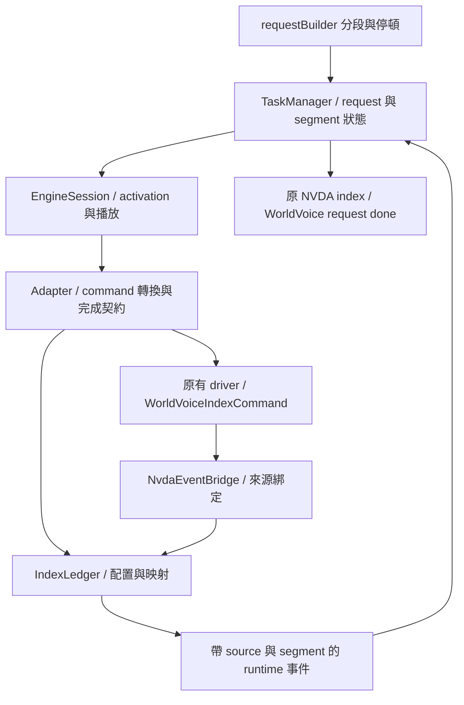

# WorldVoice 分段 index 與 request 完成通知設計

日期：2026-09-27。程式基準：`cbf7dde` 與目前工作目錄。

狀態：使用者已同意並要求撰寫 [實作計畫](../plans/2026-09-27-worldvoice-segment-index.md)；尚未實作或完成實機驗證。

## 1. 需求與已確認決策

使用者已選擇以專用結尾 index 管理 WorldVoice 的語音分段進度，並指定 command 名稱為 `WorldVoiceIndexCommand`，繼承 NVDA 的 `IndexCommand`。整筆 `speechSequence` 所建立的 request 完成時，仍由 WorldVoice 向 NVDA 發出 `synthDoneSpeaking`。Done 是通知，不是附加在 sequence 尾端的 command。

目標是降低 F7 所描述的事件誤認：A 被取消後，B 重用同一 core，A 的延遲 index／done 不得完成 B 或執行 B 的進度回呼。此設計利用 driver 既有的 index 通路，不修改 NVDA OneCore／SAPI5 原始碼，也不修改原生 DLL。

本次同時回答 `active()`／`activate()` 中的 ID 比對是否需調整：保留既有 activation cache 的三項比對，新增獨立的 segment 身分與 wire index 映射。播放身分不能取代設定快取鍵，設定快取命中也不能省略新片段的標記配置。

本文件把先前討論的 `WorldVoiceIndex` 正式定名為 `WorldVoiceIndexCommand`，並承接：

- [review_gpt2.md](../../../review_gpt2.md) 的 F7 方向與後續討論。
- [語音請求生命週期設計](2026-09-24-speech-request-lifecycle-design.md) 的取消、單一 worker、尾端停頓與一次完成通知。
- [F4 activation 設計](2026-09-25-f4-voice-activation-design.md) 的設定延至下一段生效。
- [runtime 邊界設計](2026-09-26-voice-runtime-boundaries-design.md) 的純 runtime、adapter／bridge 分工與資源所有權。

## 2. 現況與問題邊界

目前 `runtime/scheduler.py` 收到來源吻合、目前 task 有效且處於 `awaiting_done` 的 DONE，即設置該 task 的完成訊號。事件只含 `source_id`，沒有來源 segment；取消 token 與 epoch 驗證的是目前 task，不能證明回呼屬於它。

目前 `runtime/session.py:EngineSession.activate()` 記錄最後成功套用的 `(source_id, voice_key, revision)`。`source_id` 在 session 開啟資源時更新，同一次資源生命週期內的各段共用；`compat/voiceFacade.py:active()` 只是轉交 session。這個快取解決重複 setter、快取語音 A → B → A 與參數 revision 問題，不承擔事件去舊的責任。

NVDA 公開的 `synthIndexReached` 回傳 synth 與整數 index，不保留 command 的 Python 型別；`synthDoneSpeaking` 只有 synth。NVDA 自己也會在語句結尾加入 index，並以 index 追蹤語句進度，但仍在設定組態切換等流程等待 done。本機參考位置為 `ref/nvda/source/speech/manager.py` 的 `_processSpeechSequence`、語句結尾處理及 `_handleDoneSpeaking`；這不是所有 NVDA 版本或所有引擎的保證。

F7 目前已由 fake 事件情境證明辨識資訊不足；OneCore／SAPI5 實機是否出現該時序及頻率仍未證明。本設計不以「缺少 ID」直接推論全部引擎都有實際故障。

## 3. 方案比較與範圍

| 方案 | 取捨 | 決策 |
| --- | --- | --- |
| 每段附加 `WorldVoiceIndexCommand`，配置整數並維護映射 | 沿用既有 driver 通路；需確認 marker 時序、整數範圍與取消後的映射管理 | 採用 |
| 修改底層事件使每個回呼都帶 segment ID | 可直接表達來源，但需要介入各 driver 回呼 | 不作為本次必要前提 |
| 每次取消後重建 core | 用物件身分隔離事件，但有啟動延遲及資源成本 | 不作為日常取消策略 |

範圍包含 command 定義、播放 context、index 配置與還原、bridge 事件輸入、scheduler 分段完成條件、adapter 完成能力，以及相關契約測試與實機驗證要求。

不包含 registry 全面重構、pipeline 設定整理、UI 交易改造、設定檔遷移、合併 VE／Cerence 底層 driver。保持 manifest、voice key、既有設定格式與角色 mapping 相容。

目標涵蓋所有內建引擎。啟用採逐 adapter 驗證：尚未滿足本 spec 完成契約者保留明確的 legacy 完成模式，不宣稱 F7 已處理。完成模式於資源建立時固定，不能在一次播放漏掉 marker 後，偷偷改用任意 done 宣告成功。所有目標引擎通過前，不宣稱整項遷移完成。

## 4. 身分模型：activation ID 與 segment ID 分開

| 名稱 | 生命週期與用途 | 是否隨每段改變 |
| --- | --- | --- |
| `source_id` | session 資源的一次開啟身分，用於來源檢查與 activation cache | 否；資源重開／替換時更新 |
| `voice_key` | 語音描述的穩定 key，例如 `OneCore:voice-id` | 選用另一角色時改變 |
| `revision` | 該語音待生效參數的版本 | 參數修改／回復造成值改變時增加 |
| `request_id` | 一次 `speechSequence` 提交，可能包含多段與停頓 | 每筆 request 改變 |
| `epoch` | 全部取消時使舊 request 失效的世代 | 每次全域取消改變 |
| `segment_id` | scheduler 配置的單次語音 task 身分，在 scheduler 生命週期內不重用 | 是；即使同語音、同參數也不同 |
| `wire_index` | 實際交給 driver 的整數 bookmark，用映射還原事件用途 | 每個送出的 index 配置新值 |

`source_id` 是不透明物件，以身分比較。不能改為 voice ID、engine 名稱，也不能在每個 segment 或一般 cancel 時輪替來模擬事件識別。底層 synth 物件未變時，bridge 只會看到同一個來源，輪替 binding 不會使舊回呼自行帶回舊 source ID。

### 4.1 `activate()` 的決策

保留 `_applied = (source_id, voice_key, revision)`，不加入 `segment_id`、`wire_index` 或 `epoch`。

| 情境 | 是否重新套用參數 | 分段事件識別 |
| --- | --- | --- |
| A → A，相同 revision、相同資源 | 第二段可命中快取 | 每段仍有獨立 segment 與結尾 index |
| A → B → A，即使 A revision 未變 | 每次角色切換均重新套用 | 三段各自識別 |
| 同 A，rate 更新或 discard 還原 | 下一段依新 revision 套用 | 新段配置新標記 |
| 同 A，資源重開／替換 | source 改變，清空快取後完整套用 | 新來源重新綁定；若重用同一 core，仍依不重用的 index 映射拒絕舊事件 |
| 一次 apply 途中失敗 | 快取無效，下次完整重試 | 該段失敗，不得送出成功完成 |
| A 取消後再播放 A | 不因 segment／epoch 不同而強制重套 | 舊映射失效，新段仍獨立 |

最後一列延續現有 cancel 行為；若特定 adapter 的 cancel／錯誤復原會改寫 voice 或參數，該 adapter 必須讓 session cache 失效，再允許後續 activation。這是底層狀態是否仍可信的契約，不能用增加 segment ID 到 cache key 掩蓋。

增加兩項回歸保障：同語音兩段「apply 一次、marker 兩個」；取消後「舊 marker 無效、新 marker 有效」，即使新段 activation 回傳 False 也仍須正常播放。`activate()` 的 False 表示設定無需重套，不表示 segment 已完成或應跳過。

## 5. 元件責任與事件流



`IndexLedger` 為 WorldVoice 邊界的新責任名稱，保存整數映射，不決定 request 是否完成。正式 runtime 不匯入 NVDA、`IndexCommand`、compat 或具體 driver；NVDA command 建立與識別在 adapter／邊界模組完成。

- **builder**：維持目前 SelectVoice、Pause 與不可用語音區段政策，建立完整 request；不配置 wire index。
- **scheduler**：配置 segment 身分、保存有效狀態，判斷何時可結束該段、處理停頓與整筆完成。仍是唯一完成已提交 task 的 worker。
- **session**：activation 取得最新設定 snapshot；把播放 context 與 token 傳給 adapter。不持有第二份 request 狀態機。
- **adapter**：複製本段 commands、轉換 NVDA indexes、附加結尾 marker；提供該引擎的完成契約。不得原地修改呼叫者的 sequence 或 command。
- **ledger**：按實際 notification source 管理配置器，映射 wire index 至 source／segment／用途／原 index 序列；處理登記與失效。
- **bridge**：註冊 NVDA 通知、保護來源物件身分，將 index 交 ledger 解碼；對外仍使用 WorldVoice owner。不得用「目前 segment」替未知事件補身分。

同一 core 的 alias 必須共用 ledger 的配置器與有效來源所有權。不同 adapter 不能各自從 1 開始配出會碰撞的索引。

### 5.1 runtime 播放 context 與事件

在播放介面增加不可變的 `PlaybackContext(source_id, segment_id)`；request／epoch／token 仍由 scheduler 管理，adapter 只讀取所需 context 與取消狀態。每次 `speak` 呼叫必須取得該段 context，不能透過全域 current 欄位回推原始事件。

對 marker 模式，runtime 事件至少表達：

- `INDEX(source_id, segment_id, original_index)`：原 NVDA index 的還原結果。
- `SEGMENT_END(source_id, segment_id)`：有效專用結尾標記已到達。
- `SEGMENT_DRAINED(source_id, segment_id)`：僅用於需要額外播放屏障的 adapter，必須有真實來源關聯。
- `SEGMENT_FAILED(source_id, segment_id, error)`：adapter 可明確辨識的本段失敗。

現有無 segment 的 DONE 在 marker 模式不會推進 task。legacy 模式可保留既有處理，且測試／紀錄必須明確標示沒有 F7 保證。

## 6. `WorldVoiceIndexCommand` 與編號規則

預定定義於 `addon/synthDrivers/WorldVoice/_speechcommand.py`：

```python
from speech.commands import IndexCommand


class WorldVoiceIndexCommand(IndexCommand):
    """WorldVoice-only marker at the end of a speech segment."""

    def __repr__(self):
        return f"WorldVoiceIndexCommand({self.index!r})"
```

沿用 IndexCommand 的建構子、整數驗證與既有 driver 的 `isinstance` 處理。此型別用來表達送出端意圖，不在 command 上另存可變的 request／完成狀態。檢查 command 類別時，必須先區分此子類別與一般 IndexCommand；正式上游輸入不應含有由外部呼叫者自行建立的內部 marker，遇到時拒絕該筆建構，避免雙重附加或把內部標記當外部 callback。

每個真正送入 driver 的語音 segment 尾端恰有一個此標記。停頓 task、無效／不可用語音而被跳過的區段不建立標記。保留 builder 對含有 commands 但無可聽文字的片段之既有行為；adapter 的驗收必須證明這類片段仍能回報尾端標記，不能靠加入可聽字元迫使它工作。

後續討論已確認：builder 在遇到 SelectVoice、Pause 及 sequence 結尾時 flush 已累積的非空語音段。標記在 adapter 真正送入 driver 前附加；`normalize_legacy_commands()` 維持 Voice／BreakCommand 正規化，不承擔分段、編號配置或標記附加。

### 6.1 index 隔離

一般 NVDA index 與內部 marker 全部由同一來源配置器分配 wire index：

| 原始輸入／用途 | 傳入 driver | 映射結果 |
| --- | --- | --- |
| `IndexCommand(123)` | 新建 `IndexCommand(501)` | 還原 original_index 123，屬於 segment A |
| segment A 結尾 | `WorldVoiceIndexCommand(502)` | 只產生 A 的 SEGMENT_END |
| segment B 結尾 | `WorldVoiceIndexCommand(503)` | 只產生 B 的 SEGMENT_END |

driver 回傳的都是整數，不能以收到事件後做 `isinstance` 取代 ledger。一般 index 必須還原才轉送；內部結尾 index 不出現在 NVDA callback、游標索引或對外進度中。

每段送出前先一次配置並登記該段所有 wire indexes，失敗時撤回登記並使 request 失敗，不可先送部分 commands。標記可在 `speak()` 內同步回傳，因此登記與 scheduler 等待狀態必須先完成。

正常完成、取消、建構／執行失敗與 shutdown 均須撤銷該段的有效映射，並可重複清理。撤銷不得取消已分配整數的退休狀態；解碼後已在交付途中的事件仍受 scheduler 的 source／segment／token 檢查保護。

### 6.2 範圍、重用與資源重開

adapter 能力必須宣告並驗證可接受的正整數範圍，不假定負數、任意大整數或 NVDA 的 9999 上限適用所有第三方引擎。未驗證範圍者不可啟用 marker 模式。

在同一實際 notification source 的生命週期內採單調配置且不環繞重用。完成／取消後可刪除 segment 的詳細映射，但不倒退配置器；因此晚到的已退休整數只會成為未知事件。配置器記憶體不必為每個歷史 index 保留 tombstone。

source binding 改變而 core 物件仍相同時，配置器不能重置；只改 `source_id` 無法改變底層回呼的物件來源。必須保留該物件的配置高水位，或拒絕不安全的重新綁定。只有真正不同的 notification source 才能使用新的配置器，bridge 保留物件參照避免以裸 `id()` 重用造成混淆。

可用範圍不足以配置整段時，於送出前回報明確錯誤，不包回 1、不悄悄降級至 done。本 spec 不引入自動重建機制；範圍容量與長時間朗讀是啟用驗收的一部分，容量過小的 adapter 不能以此方式正式啟用。

### 6.3 被 driver 略過的原 index

NVDA 本機程式已有處理「連續 index 且中間無文字，driver 可能略過其中一個」的邏輯。附加結尾 marker 後，不能讓原本語句最後一個 NVDA index 永久遺失。

ledger 保存同段原 index 的命令順序。對已驗證 index 有序的 adapter，收到有效的後續 index／結尾 marker 時，可依序補交該段尚未交付的前置原 index，沿用既有同段去重政策；必須先交付這些原 index，再接受該段完成。禁止跨 segment、跨取消邊界或僅憑未知較大數值推定進度。

補交只依賴有效 marker 到達與有序契約，不是 timer 或任意 done 的 fallback。原 index 與內部 marker 相鄰、整段只有 commands／index、重複原 index 均列為必要案例。

## 7. 分段完成與實際播放邊界

每個 adapter 在 open 時固定選擇下列契約之一：

| 完成模式 | 本段成功條件 | 適用要求 |
| --- | --- | --- |
| `END_INDEX` | 有效 SEGMENT_END 已接收、前置原 index 已交付、`speak()` 正常返回 | 已證明尾端 marker 足以安全交接下一段 |
| `END_INDEX_AND_DRAIN` | 前述條件加上同段的 SEGMENT_DRAINED | index 提早，但 WorldVoice 邊界能取得具 segment 來源的播放屏障 |
| `LEGACY_DONE` | 保留既有 done 契約 | 遷移過渡，未涵蓋本 spec 的 F7 保證 |

END_INDEX 中的「安全交接」需包含：切換同 core voice／參數不影響前段尚未處理內容、跨引擎不出現不被允許的重疊，以及尾端停頓起算符合既有行為。只證明能收到某個數字不足以啟用。

同步 `speak()` 可能在返回前送出 marker。callback 只記錄事件，worker 等 `speak()` 返回後才完成 task；如果 marker 已收到但隨後 speak 拋錯，該段仍失敗。所有事件還須通過 source、segment、request epoch、token 與目前 phase 檢查。

若 adapter 使用 END_INDEX_AND_DRAIN，屏障必須在原始播放工作建立時關聯 segment。收到「本段 marker」後再收到「任意 done」不構成此屏障；done 仍可能來自舊段。沒有可證明屏障時，維持 LEGACY_DONE 並記錄限制，不捏造 SEGMENT_DRAINED。

### 7.1 各引擎的現有證據與啟用條件

| 引擎 | 原始碼觀察 | 正式啟用 marker 模式前必須證明 |
| --- | --- | --- |
| OneCore | marker 位置以播放器 onDone 通知；marker 後仍可能有音訊 | 尾端 marker、無文字片段、取消後 marker、參數切換與音訊尾段的交接語意 |
| SAPI5 | WASAPI bookmark 使用播放器回呼；EndStream 路徑會補送未觸發 bookmark | WASAPI／legacy 分別驗證；補送是否早於播放完畢、取消／佇列時序及 int 範圍 |
| VE／Cerence | index 可由 native 合成回呼直接通知；同步 speak 的結束路徑含 player.idle | marker ＋ speak 返回是否足以保留音訊尾段、取消 guard 與 chunk 行為 |
| RHVoice | mark 經 AudioPlayer；done 路徑另等待 idle | marker 與排空關係、取消旗標與工作佇列的後續事件 |
| Espeak | 使用 NVDA 的 driver | 對目標 NVDA 版本檢查 index 完成／取消契約與實機結果 |
| external | 由外部實作決定 | 子類別可接受、index 可靠性／範圍、完成與取消契約 |

此表列的是驗證要求，不是已通過的能力宣告。不改 NVDA 原始碼仍是本次約束；若無法透過公開通路或 WorldVoice 邊界取得所需保證，不能聲稱該引擎已完成新模式遷移。

## 8. 取消、失敗與事件順序

保留 epoch、token、目前來源／phase、delivery lock、`_stops_in_flight` 與單一 worker 的現有保護。

1. 取消先使 request／token 失效並喚醒等待，再使相關映射失效，最後呼叫底層 cancel。即使映射撤銷與 callback 交錯，scheduler 仍以 token／segment 拒絕事件。
2. 新工作仍等待進行中的 stop 呼叫返回；這不是排空保證，也不能取代 segment 身分。
3. 同 core 新段開始後，舊 marker／index／done 不改變新段；已進入 bridge 而尚未交付的舊事件也要在輸出前重新驗證。
4. 每段原 index 的輸出順序不得被同步或其他執行緒的結尾 marker 超越。先前已接受的原 index 完成交付後，worker 才可完成該段。輸出重入取消時立即停止該段後續交付。
5. bridge／ledger 的內部鎖只保護快照與狀態，不能持鎖呼叫 scheduler、NVDA 通知、driver 或 Future callback。scheduler 保持 delivery lock → state lock 的順序。
6. apply／編碼／speak／明確 adapter failure 發生時，撤銷該段映射、取消 request 剩餘工作並保留診斷；不能讓 marker 已到達掩蓋失敗。
7. 只有底層 done、未收到 marker 時，不判定成功。啟用的 adapter 必須能在正常完成送出 marker，並在已知失敗送出錯誤或讓 speak 拋錯。完全無訊號的引擎停滯屬於另需處理的 liveness 限制；本次保持可取消／可喚醒等待，不加入猜測完成時間的 timer。若 synchronous native call 永遠不返回，現有 shutdown 阻塞限制仍存在，不能由本次 marker 設計宣稱已解決。
8. shutdown 先關閉新 request 入口、取消／停止 worker 使用資源，再關閉 bridge／ledger 與 engine。late callback 不得復活已關閉的映射或 request。

## 9. WorldVoice 對 NVDA 的完成通知

```text
request R
  語音段 A + WorldVoiceIndexCommand(a)
  語音段 B + WorldVoiceIndexCommand(b)
  尾端 Pause
       ↓ 全部成功完成
  synthDoneSpeaking.notify(synth=WorldVoice)
```

底層 done 與對外 done 是兩個方向。marker 模式不以底層 done 推進片段，但 WorldVoice 對 NVDA 的通知仍維持現有 policy：

| request 狀態 | 對 NVDA 的行為 |
| --- | --- |
| 含語音且成功完成所有 task，包括尾端停頓 | 最多一次 WorldVoice done |
| 已取消、epoch 過期、shutdown 或 owner 已切換 | 抑制該 request 的 done |
| 提交後執行失敗 | 沿用目前 FAILED 可發一次 done 以釋放上層等待的政策，同時記錄錯誤、取消剩餘 task；此通知不表示成功 |
| 建構期失敗／從未提交 | 不發成功完成通知 |
| 空 request 或只有 Pause、沒有 speech task | 維持既有不發 done 行為 |

成功完成仍由 `remaining == 0` 判斷。失敗通知沿用現有 terminal state 規則，不能誤寫成「失敗後繼續播放全部 task 才通知」。NVDA 的 done 事件本身沒有成功／失敗欄位，錯誤狀態由 runtime Future／request 與 log 表達。

每個 request 各自保存 `done_sent`，不等待整個全域 queue 清空才通知，也不將每段內部 marker 轉成對外 done。完成通知前仍檢查 epoch／owner，避免 callback 重入取消後送出舊通知。

## 10. 驗收條件

### A. command 與 index 映射

1. `WorldVoiceIndexCommand` 是 `IndexCommand` 子類別，使用相同整數驗證，driver 的既有 index 分支可接受。
2. 每個有效語音段尾端恰一個 marker；Pause 不附 marker；呼叫者原始 commands 不被修改。
3. 原 NVDA index 與內部 marker 取得不同 wire 值；一般回呼還原原 index，內部 marker 不外洩。
4. 相鄰原 index／結尾 marker 中被略過的原 index 可按同段順序補交；callback 重入取消後不再補交。
5. 空文字、只有控制命令、只有 index、重複原 index 的行為可完成或明確失敗，不靠任意 done 假裝成功。
6. 同來源 alias 共用配置器；完成／取消不重用 wire 值；小範圍耗盡測試明確拒絕送出；同 core rebind 不重置高水位。

### B. F7 與 scheduler

7. 同 core：A cancel → B start → A late marker／index／done，B 的 Future、進度與完成通知均不受影響。
8. 同 request：前段重複 marker／done 在後段等待時到達，不完成後段。
9. 正確來源但錯 segment、未知 wire index、不同來源及 WorldVoice 自己的通知均不誤推進。
10. 在 speak 內同步送 marker 可正常完成；marker 後 speak 拋錯仍失敗；callback 本身不遞迴啟動下一段。
11. index-only 路徑只送底層 done 時不完成；取消可以解除等待；有來源的 failure 正確中止 request。
12. 原 index 交付順序、Future callback 重入、cancel／停頓／shutdown 與 `_stops_in_flight` 既有契約保留。

### C. activation 與 request 完成

13. 相同語音／revision 的連續兩段，apply 次數不增加，兩段 marker 不同且各自完成。
14. A → B → A、revision 更新／rollback、apply 失敗後重試、replace adapter 全部維持既有 cache 語意。
15. activation 命中快取但前段已取消時，新段仍分配標記並播放；不因 False 回傳跳過。
16. 多段加尾端 Pause 僅在整筆完成後對 NVDA 發一次 done；取消零次；FAILED 沿用一次釋放等待；空／只有 Pause 維持原政策。

### D. 整合證據

17. native 測試 adapter 與 legacy adapter 使用同一正式 scheduler／session／settings 契約；純 runtime 仍禁止 NVDA／compat／driver imports。
18. Windows／NVDA 驗證 OneCore、SAPI5 WASAPI／legacy、VE／Cerence、RHVoice、Espeak 的 marker 與音訊完成契約，逐一記錄版本及完成模式。
19. 情境含長時間朗讀、快速取消後重播、同引擎換角色、跨引擎、說全部、設定組態切換、pause/resume 與尾端停頓；記錄有無聲音重疊、提前切換與 index／done 次數。
20. 驗證結果分為來源碼觀察、fake 契約、實機結果。只有 fake 通過時，不宣稱真實音訊排空或整個 F7 已修正。

## 11. 實作前的審閱重點

對話已確認的主決策是 command 名稱、marker 管分段與 WorldVoice done 管 request。針對使用者提出的 active ID 問題，本 spec 建議保留 activation cache 三元組，新增獨立的 segment 身分。本 spec 另補充的設計選擇為：完整 index 重新編號、每個實際來源不環繞重用、按 adapter 完成契約逐步啟用，並保留既有 FAILED 的通知政策。

書面審閱應確認上述選擇與相容性取捨。每個引擎的整數範圍與播放時序由實作／驗證階段產出能力證據；缺少證據時維持 legacy 模式，而非以未定義行為啟用。這是明確的啟用限制，不是由實作者自行猜測的參數。

本次只產出設計文件與討論文件的命名同步，不修改 addon 程式、不宣稱已執行 pytest 或 Windows 驗證。
